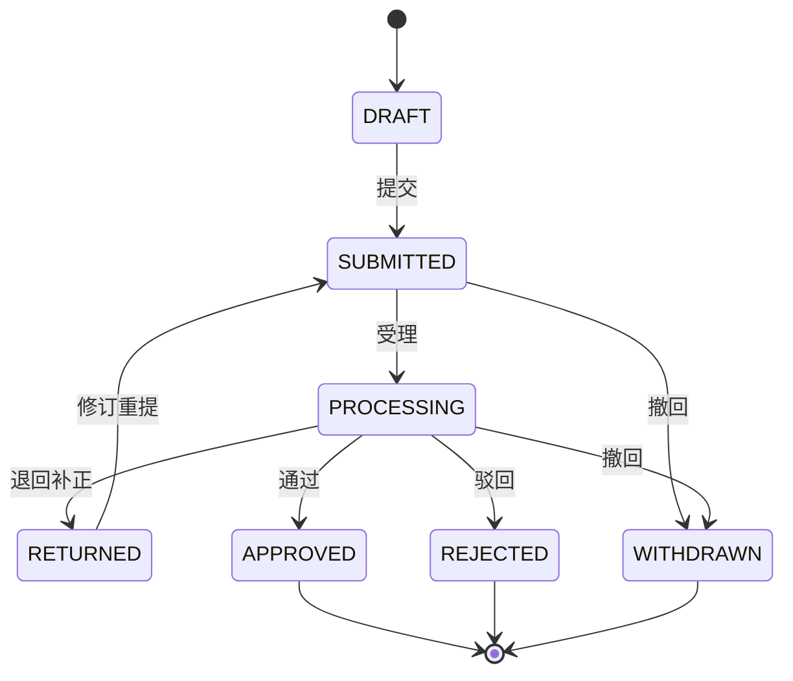
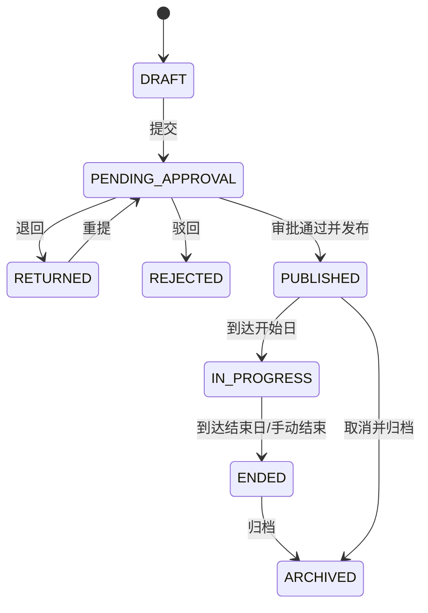
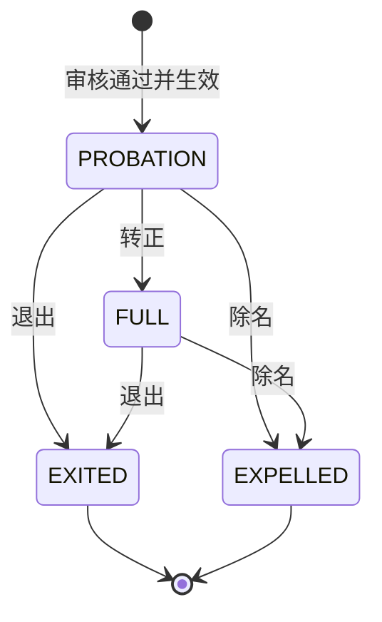
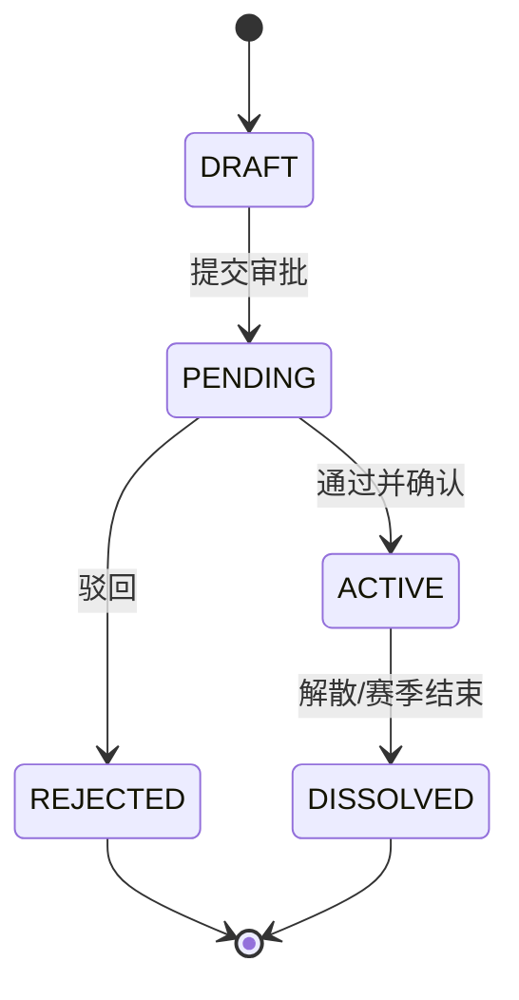
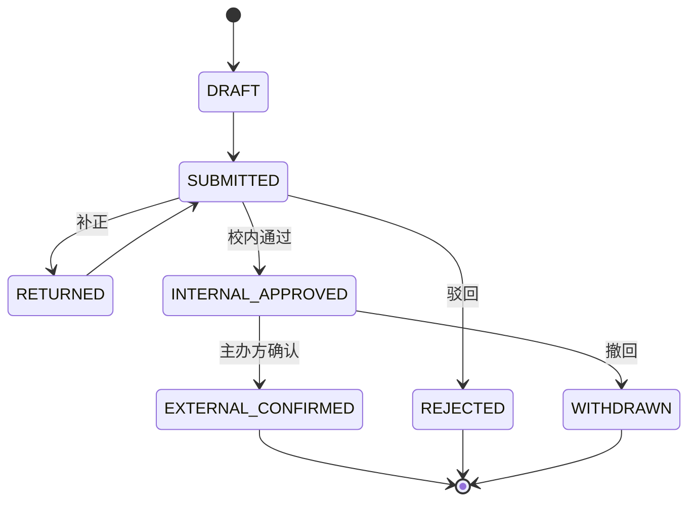
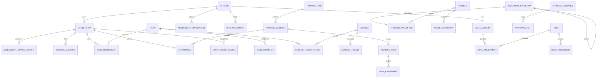

# ADR-0002 领域模型 v1：身份五维、状态机与快照

- **状态**：Accepted（2026-11-26）
- **决策人**：项目负责人
- **关联**：GOV-001 v1.1.0 第 5 章 DOM-01 至 DOM-36、FR-01 至 FR-44、BR-01 至 BR-21、Q-01 至 Q-15
- **物理落库**：P0-02 的 Flyway `V1` 迁移；本文件只定逻辑模型与不变量

---

## 1. 范围与已定决策

本文件确定"人—身份—任职—队伍—训练—竞赛—审批"的逻辑模型。物理表名、索引、约束在 P0-02 细化，但**不得违反**本文件的不变量。

| 编号 | 决策 | 依据 |
|---|---|---|
| D-01 | **Q-02 分开建模**：新会员默认进入 `PROBATION`（备选）；"观察"是**考核状态**，不是会员生命周期 | 用户 2026-11-26 确认；规格 2.1、Q-02 |
| D-02 | **Q-03 包含关系**：`集训队队员 ⊂ 竞赛实验室成员`，用身份类型层级表达；授予子类型时按层级蕴含父类型 | 用户 2026-11-26 确认；规格 2.1、Q-03 |
| D-03 | 身份五维分开存储：会员生命周期、考核状态、培养身份、组织任职、队伍关系 | DOM-01 |
| D-04 | 所有任职、身份、队伍关系**带有效期**；到期由任务置为失效，历史行保留 | FR-01、DOM-02 |
| D-05 | 审批通过与业务生效**分开记录**：审批实例只记决策，业务对象另有 `effective_at` | 规格 7.1、DOM-03 |
| D-06 | 审批轨迹、署名、比赛阵容、计划版本、规则版本一律**快照/不可变** | DOM-04、DOM-17 |
| D-07 | 阈值全部进 `rule_config`；未确认项 `value=null` 且 `mode=MANUAL` | DOM-12、Q-04/Q-05/Q-08 |
| D-08 | 已产生业务结果的记录不物理删除；分类被引用只停用/合并 | DOM-05、DOM-19、BR-21 |
| D-09 | "申请中"是**申请单状态**，不是会员行；会员行从备选开始。生命周期视图合成"申请中" | 见 3.1；避免同一事实两处存储 |
| D-10 | 通用审批引擎支持 N 级节点，首期默认 1 级；审批人按角色 + 数据范围解析 | Q-11 未定，先可配置 |

## 2. 建模总则

1. **单一事实来源**：一个人一份 `person`；一个会员一份有效 `membership`；一个账号一份 `user_account`。
2. **身份不等于权限**：会员/队员/队长是业务身份；能否操作由 `role_assignment` + 权限点 + 数据范围决定，两者不互相推导（队长不自动获得系统角色，除显式授予）。
3. **状态机驱动**：状态只能按第 4 节迁移；越级修改走管理员工单并留审计。
4. **不可变快照**：`*_version`、`team_snapshot`、`application_version`、`approval_step`、`audit_log` 只插入，不更新。
5. **时间**：所有区间 `[valid_from, valid_to)`，`valid_to=null` 表示长期；判定"当前有效"用注入的 `Clock`，不用数据库 `now()` 散落各处。
6. **标识**：主键 UUID；业务编号（学号、会员号、队伍编号）另设唯一约束，可读但不作为外键。

## 3. 身份模型

### 3.1 会员生命周期（`membership.lifecycle`）

```text
（申请单：DRAFT/SUBMITTED/PROCESSING/RETURNED/APPROVED/REJECTED/WITHDRAWN）
                              │ 审核通过 + 生效
                              ▼
PROBATION（备选） ──转正──▶ FULL（正式）
      │                         │
      ├────────退出/除名────────┤
      ▼                         ▼
   EXITED（退出）           EXPELLED（除名）
```

- 会员行在"审核通过并生效"时创建，初始 `PROBATION`；综合管理类可直接 `FULL`（按申请类别配置）。
- `EXITED` / `EXPELLED` 为终态；重新入会创建**新行**，`previous_membership_id` 指向旧行，不复活旧行。
- 生命周期视图 `v_member_lifecycle` 对"有进行中申请且无会员行"的人输出 `APPLYING`，仅用于查询/界面，不落库。
- 生命周期与考核状态**正交**：`FULL` 也可以是 `OBSERVING`。

### 3.2 考核状态（`assessment_status_history`）

- 取值：`PENDING`（待考核）、`QUALIFIED`（合格）、`OBSERVING`（观察）。
- 观察必须关联 `observation_record`：原因、起止、证据、决定人；结束观察需决定（恢复 `QUALIFIED` 或维持/转其他）。
- 历史表按 `effective_from` 追加；当前状态取有效区间覆盖当下的一行。
- **未评估 ≠ 0 分**：统计层用 `NOT_ASSESSED` 表示缺数据，不写 0。

### 3.3 培养身份（`training_identity` + `training_identity_type`）

身份类型是**层级**，不是枚举：

| code | 名称 | parent | 说明 |
|---|---|---|---|
| `LAB_MEMBER` | 竞赛实验室成员 | — | Q-03 的父类型 |
| `TEAM_MEMBER` | 集训队队员 | `LAB_MEMBER` | 子类型；有效期内蕴含父类型 |
| `FRESHMAN` | 新生 | — | 培养阶段身份，可与上两者并存 |
| `MENTOR` | 导师/师傅 | — | 与 `mentor_relation` 配合，带教人数受 BR-09 约束 |
| `ASSISTANT_COACH` | 助理教练 | — | 普及组带教 |

- 只存**直接授予**的身份行；"有效身份"由 `training_identity_closure`（类型层级闭包）展开，不重复落行。
- 结束子身份（如退出集训队）**不会自动结束**父身份；父身份是否保留由业务决定并单独留痕。
- 授予/结束都要记录来源（申请、选拔、任命）与决定人。

### 3.4 组织任职（`org_assignment`）

- 维度：`person` × `department` × `position` × `term` × 有效期。
- 一人可兼多岗；同一 `(person, position, term)` 同时只能有一条有效行。
- 任职到期或免职：`org_assignment` 置失效，**派生角色**（如部长）的 `role_assignment` 同步失效；历史任职仍可查（FR-01）。
- 离任交接：待办转交指定继任者，原审批轨迹与署名不替换（规格 7.2-5）。

### 3.5 队伍关系（`team` + `team_membership`）

- 队伍类型：`XCPC`（正式 3 人）、`OTHER`（校赛/非 XCPC，按赛事配置）。
- 成员关系带 `joined_at/left_at`；同一队伍同时只有一名有效队长。
- 正式确认校验 3 名有效成员；草稿允许未满员（BR-13、AT-06）。
- 报名/参赛时生成 `team_snapshot`（成员、队长、赛事、时间、原因）；后续调整不改写快照（DOM-04）。

### 3.6 权限与身份的关系

- `role_assignment` 独立于业务身份：`user_id + role_id + scope_type + scope_id + [valid_from, valid_to)`。
- `scope_type`：`SELF` / `TEAM` / `DEPARTMENT` / `GLOBAL`；`GLOBAL` 时 `scope_id=null`，其余必填。
- 生效权限 = 角色权限点 ∩ 数据范围 ∩ 时间有效；`token_version` 变更立即失效会话。
- 申请人/备选会员默认只有 `SELF` 范围，不能读取他人档案（NFR-02/03）。

## 4. 核心实体

> 字段只列关键项；所有表默认含 `id uuid`、`created_at`、`updated_at`、`version`。

### 4.1 人员、账号与权限

| 实体 | 关键字段 | 不变量 |
|---|---|---|
| `person` | `student_no`、姓名、学院、专业、年级、联系方式、OJ 账号 | `student_no` 唯一；一人一档（FR-03） |
| `user_account` | `person_id`、`username`、`password_hash`、`status`、`token_version`、失败计数/锁定 | `username` 唯一；与 person 1:1；停用即失效（TECH-12） |
| `role` | `code`、`name`、`built_in` | 11 类角色 + 系统角色；`code` 唯一 |
| `role_permission` | `role_id`、`permission_code` | 权限码来自后端枚举；CI 校验 |
| `role_assignment` | `user_id`、`role_id`、`scope_type`、`scope_id`、有效期、授予人 | 同一角色+范围不重叠；离任/到期失效（DOM-02） |

### 4.2 组织与届次

| 实体 | 关键字段 | 不变量 |
|---|---|---|
| `department` | `code`、`name`、`parent_id`、`type` | 名称待 Q-01；编码稳定，显示名可改 |
| `position` | `code`、`name`、`department_id`、`max_holders` | 岗位可跨部门复用；上限可空 |
| `term` | `code`、`name`、起止 | 届次与学期分开 |
| `semester` | `code`、`name`、起止、`type`（秋/春/暑） | 同学期编码唯一；注册与计划都挂学期 |
| `semester_registration` | `semester_id`、`membership_id`、状态、时间 | `(semester, membership)` 唯一（BR-01） |
| `business_calendar` | 日期、类型（工作日/节假日/调休）、名称、来源 | 工作日计算唯一来源（TECH-06） |

### 4.3 申请与审批

| 实体 | 关键字段 | 不变量 |
|---|---|---|
| `membership_application` | 申请人、类别（竞赛/综合）、状态、当前版本、决定、生效时间 | 同一人同一类别只允许一个进行中申请；不得自批 |
| `application_version` | `application_id`、版本号、表单 JSON、附件、哈希、提交时间 | 不可变；重提追加新版本（DOM-09） |
| `application_review` | 申请、版本、审核人、动作、意见、前后状态、时间 | 不可变；记录人/时间/意见（FR-02） |
| `approval_instance` | 业务类型、业务 ID、状态、当前步骤 | 一个业务对象可有多次审批（如重提） |
| `approval_step` | 实例、序号、审批角色、审批人、动作、意见、时间、期限 | `(instance, seq)` 唯一；不得跳过序号 |

### 4.4 会员、考核与退出

| 实体 | 关键字段 | 不变量 |
|---|---|---|
| `membership` | `person_id`、会员号、生命周期、入会/退出时间、原因、前序会员 | 一人同时只有一条非终态会员；终态不可复活（D-09） |
| `assessment_status_history` | 会员、状态、原因、证据、生效区间、规则版本、决定人 | 只追加；区间不重叠 |
| `observation_record` | 会员、起止、原因、状态、复核人 | 观察必须有原因与期限；恢复需决定 |
| `exit_request` | 会员、类型（普通/集训队）、申请日、拟退出日、审批实例、生效日 | 集训队提前 15 个工作日校验（BR-04）；审批≠生效 |
| `disciplinary_action` | 会员、类型、依据条款、证据、决定、生效日、复议结果 | 缺勤/考核异常只生成待办，不自动处罚（DOM-12） |
| `mentor_relation` | 师傅、徒弟、类型、指导小组、有效期 | 师傅同期有效徒弟 ≤3（BR-09，服务层阻断） |
| `guidance_group` | 名称、学期、类型（拔高/普及）、组长、人数上下限 | 普及 5–7 仅提示；规模调整需说明（BR-09） |

### 4.5 题库

| 实体 | 关键字段 | 不变量 |
|---|---|---|
| `algorithm_category` | `parent_id`、层级 1–3、编码、名称、简称、说明、学习阶段、建议难度、排序、状态、`merged_into_id` | 最多 3 级；同级名称唯一；被引用只能停用/合并（BR-21） |
| `category_prerequisite` | 分类、前置分类 | 必须无环；不得自指（FR-39） |
| `problem` | 标题、OJ 来源、题号/链接、难度、状态、当前版本 | 同来源+题号重复录入需提示（FR-07） |
| `problem_version` | 题目、版本号、题面、题解、难度、作者、时间 | 不可变；正式题单只引用已审核版本（FR-42） |
| `problem_algorithm` | 题目、分类、`is_primary` | **每题恰好 1 个主算法**（FR-40）；辅助算法可多 |
| `tag` / `problem_tag` | 标签类型（题型/技巧/年份/级别）、题目关联 | 标签可组合筛选（FR-40/44） |
| `import_job` | 类型、文件、哈希、状态、统计、错误明细、操作者 | 同文件重复提交返回原结果（DATA-11） |

### 4.6 训练与培养

| 实体 | 关键字段 | 不变量 |
|---|---|---|
| `training_plan` | 学期、类型（学期/寒假/暑假）、标题、状态、当前版本、起止、负责人 | 发布版本不可变；变更发新版本（DOM-10） |
| `training_plan_version` | 计划、版本号、内容 JSON、发布时间、审批人 | 不可变；历史成绩绑定原版本 |
| `training_session` | 计划、序号、标题、时间、时长、地点/线上、讲师 | 次数与单次时长分别统计（BR-06） |
| `training_task` | 计划/课次、标题、对象类型、对象 ID、截止、要求、状态 | 对象类型明确：个人/小组/队伍/全员（FR-11） |
| `task_assignment` | 任务、会员、状态、完成时间 | `(task, membership)` 唯一；个人/团队不重复计分 |
| `attendance` | 课次、会员、状态（出勤/迟到/缺勤/请假）、签到时间、补录人、原因 | 修改留原因与历史（FR-12） |
| `completion_record` | 任务、会员、题目、结果、用时、证据、核验状态、核验人 | 原始提交与最终认定分开；重复导入不重复计数（DATA-08） |
| `wrong_problem` | 会员、题目、笔记、解决时间 | 错题反馈可追溯 |
| `freshman_course` / `course_session` | 学期、课程、课次、讲师、课件、录屏 | 培训次数/时长/材料完整性可统计（FR-15） |
| `course_feedback` | 课程、会员、评分、意见、提交时间 | 3 个工作日提醒（BR-07） |
| `winter_camp` / `summer_camp` | 学期、起止、名单、周模板 | 寒假新生 4 周（BR-06）；暑训日期不预置（BR-16） |

### 4.7 竞赛

| 实体 | 关键字段 | 不变量 |
|---|---|---|
| `team` | 名称、类型、状态、成立/解散时间 | 正式 XCPC 确认时 3 人（BR-13） |
| `team_membership` | 队伍、会员、角色（队长/队员）、加入/退出 | 同时一名有效队长；历史保留 |
| `team_snapshot` | 队伍、赛事、原因、时间、成员 JSON | 不可变；成绩绑定当场快照（DOM-04） |
| `contest` | 名称、类型、级别、学期、起止、状态、是否外部 | 赛事类型可配置（NFR-07） |
| `contest_registration` | 赛事、主体类型/ID、状态、提交时间、外部回执 | 同一赛事+主体唯一；校内通过≠外部报名成功（AT-08） |
| `contest_result` | 赛事、主体、排名、奖项、原始指标 JSON、是否正式、证据、修订号 | 修订保留依据；团队奖按奖项去重（DATA-08） |
| `selection` | 赛事、规则版本、候选、结果、方式（人工/自动）、决定人 | 公式未确认时只能人工（FR-27） |

### 4.8 支撑

| 实体 | 关键字段 | 不变量 |
|---|---|---|
| `file_object` | 归属类型/ID、文件名、MIME、大小、SHA-256、存储键、可见范围、版本 | 访问经 API 鉴权 + 短时签名 URL（TECH-13） |
| `notification` | 接收人、类型、标题、正文、业务引用、已读时间 | 站内通知；外部渠道另确认（FR-29） |
| `audit_log` | 操作者、动作、对象类型/ID、前后值、IP、UA、`request_id`、时间 | **append-only**；普通用户不可改（NFR-04） |
| `rule_config` | 键、值 JSON、来源条款、版本、生效区间、执行方式（BLOCK/WARN/MANUAL） | 历史结果绑定版本（DOM-17） |
| `background_job` | 类型、载荷、状态、尝试次数、锁定时间、下次执行、最后错误 | 幂等；单实例调度（TECH-03） |
| `export_job` | 类型、筛选、状态、文件、申请人、审批人、行数 | 导出单独授权 + 审计（DATA-12） |

## 5. 状态机

### 5.1 申请（7 态）



守卫：申请人不得是最终审批人；`APPROVED` 只表示审批通过，会员生效由 `effective_at` 触发（D-05）。

### 5.2 计划（6 态）



已发布内容变更：生成新 `training_plan_version`，旧版本继续绑定历史成绩（DOM-10）。

### 5.3 会员



除名必须走告知/审议并留依据；未确认阈值只生成待办，不得自动迁移（DOM-12）。

### 5.4 队伍与报名





## 6. 不变量清单

| 编号 | 不变量 | 条款 |
|---|---|---|
| I-01 | 学号全局唯一；一人一档 | FR-03 |
| I-02 | 一人同时只有一条非终态会员；终态不可复活 | D-09 |
| I-03 | 生命周期与考核状态正交存储 | DOM-01 |
| I-04 | 有效 `TEAM_MEMBER` 蕴含 `LAB_MEMBER`；结束子身份不自动结束父身份 | D-02 |
| I-05 | 任职/身份/队伍关系均带有效期，到期失效但历史保留 | DOM-02 |
| I-06 | 同一角色+数据范围的有效分配不重叠 | DOM-02 |
| I-07 | 申请人不得最终批准自己的申请 | 规格 2.2、DOM-03 |
| I-08 | 审批通过与业务生效分离，分别记录时间与操作者 | D-05 |
| I-09 | 审批步骤按序号推进，不得跳级；轨迹不可变 | DOM-04 |
| I-10 | 每题恰好 1 个主算法；可多个辅助算法 | FR-40 |
| I-11 | 算法目录最多 3 级，前置关系无环 | FR-37/39 |
| I-12 | 被题目/题单/训练引用的分类只能停用或合并，合并保留映射 | BR-21 |
| I-13 | 正式题单只引用已审核题目版本 | FR-42 |
| I-14 | 计划发布版本不可变；变更发新版本并通知 | DOM-10 |
| I-15 | 考勤/完成记录修改必须留原因与历史，原始与认定分开 | FR-12、DATA-08 |
| I-16 | 正式 XCPC 队伍确认时恰好 3 名有效成员；草稿可不满 | BR-13 |
| I-17 | 同一队伍同时只有一名有效队长 | FR-19 |
| I-18 | 同一赛事+主体只有一条有效报名 | FR-19/24 |
| I-19 | 校内审核通过 ≠ 外部报名成功 | 规格 7.1、AT-08 |
| I-20 | 比赛成绩绑定当场阵容快照，后续调整不改写 | DOM-04 |
| I-21 | 审计日志 append-only，普通业务用户不可修改 | NFR-04 |
| I-22 | 规则版本随结果固化；改规则不影响历史 | DOM-17 |
| I-23 | 未确认阈值不得阻断、自动处罚或自动选拔 | DOM-12 |
| I-24 | 业务记录不物理删除；导出需单独权限 + 审计 | DOM-05、DATA-12 |

## 7. 关系图（核心）



## 8. 与待确认问题的关系

| Q | 模型承载方式 |
|---|---|
| Q-01 部门名称 | `department` 编码稳定、名称可改；种子用"竞赛部"，别名待确认 |
| Q-02 观察会员 | 已定：默认 `PROBATION`；观察 = `assessment_status=OBSERVING`（D-01） |
| Q-03 实验室/集训队 | 已定：类型层级 `TEAM_MEMBER → LAB_MEMBER`（D-02） |
| Q-04 除名阈值 | `rule_config` 空值 + `MANUAL`，只生成待办 |
| Q-05 能力/评分/排序 | 只存人工评分与证据；公式字段留空，不预置综合分 |
| Q-06 考核与身份转换 | 转换规则配置化；默认不自动转正/淘汰 |
| Q-07 暑训日期笔误 | 不设默认日期；`summer_camp` 起止由负责人填 |
| Q-08 排序/名额 | `selection.mode=MANUAL`；公式未定不启用自动 |
| Q-09 寒训对象 | `winter_camp` 名单按学期配置，不写死群体 |
| Q-10 P2 范围 | 财务/资产/活动/换届不建表，仅保留扩展位 |
| Q-11 审批链 | N 级 `approval_step`；默认 1 级，按角色+范围解析 |
| Q-12 集成 | 首期 file import/export；不建外部 API 表 |
| Q-13 规模 | 单机；不做分库分表；索引按查询建 |
| Q-14 制度版本 | `rule_config` 与文档版本绑定，变更留痕 |
| Q-15 目录级数 | 固定 3 级；初始 10 大类可配置 |

## 9. 物理落库约定（P0-02 执行）

- 枚举用 `varchar + check`，不用 PostgreSQL enum（便于加值）；JPA `@Enumerated(STRING)`。
- JSON 快照用 `jsonb`；表单/计划内容不拆成宽表。
- 唯一索引示例：`person(student_no)`、`user_account(username)`、`membership(person_id) where lifecycle in ('PROBATION','FULL')`、`problem_algorithm(problem_id) where is_primary`、`team_membership(team_id) where role='CAPTAIN' and left_at is null`。
- 外键 `on delete restrict`；不级联删除业务数据。
- `audit_log` 仅授予 `INSERT`/`SELECT`；应用账号无 `UPDATE/DELETE`。
- 时间列 `timestamptz`；金额 `numeric(12,2)`；比率 `numeric(6,4)`。

## 10. 后果

- 身份/任职/队伍都带有效期，查询需统一"as-of"参数；P0 提供 `AsOf` 工具与索引，避免每个接口各写一套。
- 类型层级闭包使"实验室成员"统计可直接查父类型；但结束子身份不自动结束父身份，需要业务显式操作与提示。
- 申请单与会员行分离，避免"申请中会员"半成品数据；代价是生命周期查询需 union 视图。
- 快照表增多，写入放大；以"只在关键节点快照"控制（报名、发布、审批、成绩）。